# Calibration framework for Zuppo robot
Zuppo is a low-cost, DIY differential-drive robot built for 3D reconstruction using two 2D LiDARs. This repository contains the robot software, calibration tools, and datasets. The thesis presents an offline, targetless calibration framework that estimates the odometry parameters and both LiDAR poses using the robot's onboard measurements.

<table align="center">
  <tr>
    <td align="center">
      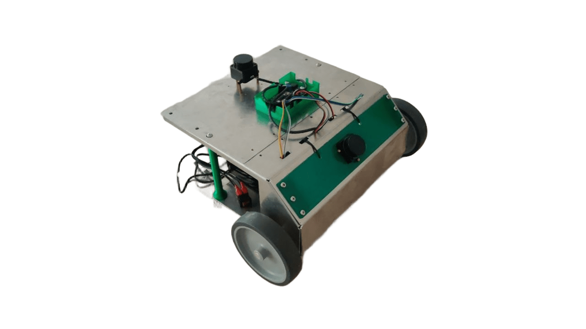<br>
      <em>Robot platform</em>
    </td>
    <td align="center">
      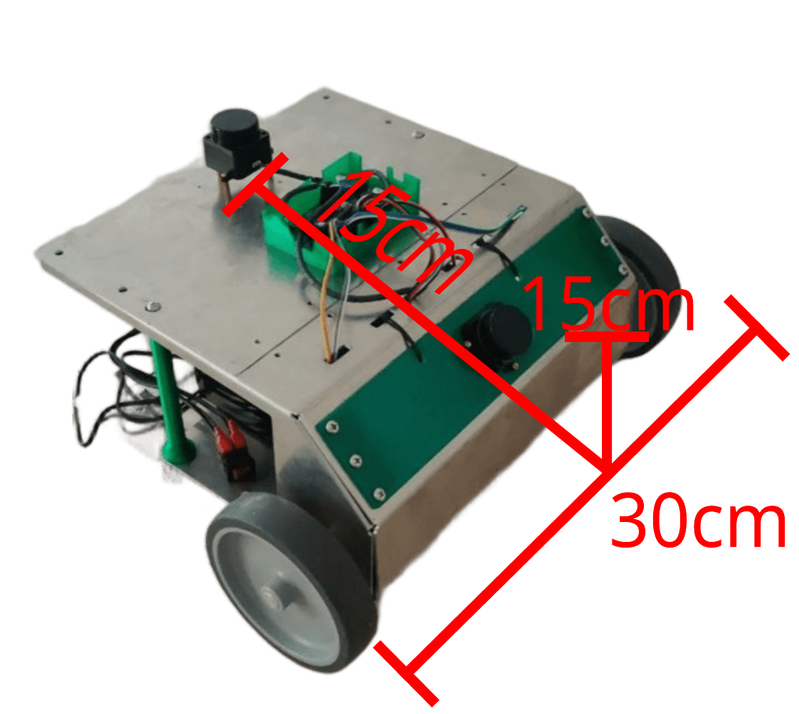<br>
      <em>Nominal measurements</em>
    </td>
    <td align="center">
      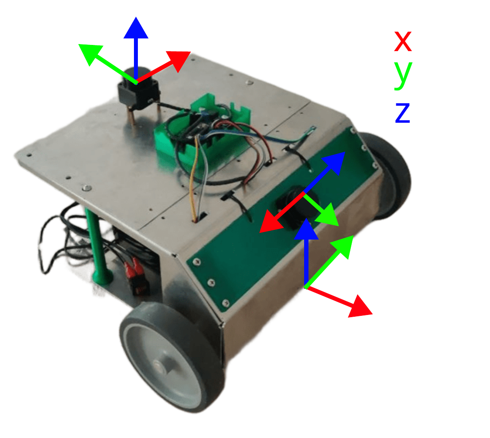<br>
      <em>Coordinate frames</em>
    </td>
  </tr>
</table>

## Nominal values in the robot reference frame

The robot frame $\mathrm{r}$ is located at the midpoint of the wheel baseline. The table summarizes the nominal odometry parameters and sensor poses relative to that frame; these are initial estimates, not the calibrated results.

| Quantity | Nominal value | Reference |
| --- | --- | --- |
| Left wheel distance per encoder tick, $k_\mathrm{l}$ | $-0.0001\ \mathrm{m/tick}$ | Odometry |
| Right wheel distance per encoder tick, $k_\mathrm{r}$ | $+0.0001\ \mathrm{m/tick}$ | Odometry |
| Wheel baseline, $b$ | $30\ \mathrm{cm}$ | Odometry |
| Horizontal LiDAR translation, ${}^{\mathrm{r}}\mathbf{t}_{\mathrm{h}}$ | $(-15,\ 0,\ 0)\ \mathrm{cm}$ | Robot frame |
| Horizontal LiDAR rotation, ${}^{\mathrm{r}}R_{\mathrm{h}}$ | $R_z(90^\circ)$ | Robot frame |
| Slanted LiDAR translation, ${}^{\mathrm{r}}\mathbf{t}_{\mathrm{s}}$ | $(0,\ 0,\ 15)\ \mathrm{cm}$ | Robot frame |
| Slanted LiDAR rotation, ${}^{\mathrm{r}}R_{\mathrm{s}}$ | $R_y(60^\circ)R_z(-90^\circ)$ | Robot frame |

The sensor rotations are written in the order used in the thesis. See the diagrams above for the measurement and axis conventions.

## Calibrated values in the robot reference frame

The horizontal LiDAR and odometry parameters were calibrated on DIAG and then refined on Hall. The slanted LiDAR was calibrated independently on both datasets; the thesis reports the resulting poses as practically the same.

| Quantity | DIAG | Hall |
| --- | ---: | ---: |
| Left wheel distance per encoder tick, $k_\mathrm{l}$ | $-9.829\times10^{-5}\ \mathrm{m/tick}$ | $-9.790\times10^{-5}\ \mathrm{m/tick}$ |
| Right wheel distance per encoder tick, $k_\mathrm{r}$ | $9.800\times10^{-5}\ \mathrm{m/tick}$ | $9.738\times10^{-5}\ \mathrm{m/tick}$ |
| Wheel baseline, $b$ | $36.8\ \mathrm{cm}$ | $37.2\ \mathrm{cm}$ |
| Horizontal LiDAR translation, ${}^{\mathrm{r}}\mathbf{t}_{\mathrm{h}}$ | $(-14.5,\ 0.8,\ 0)\ \mathrm{cm}$ | $(-13.8,\ 0.2,\ 0)\ \mathrm{cm}$ |
| Horizontal LiDAR rotation, ${}^{\mathrm{r}}R_{\mathrm{h}}$ | $R_z(92.4^\circ)$ | $R_z(92.0^\circ)$ |

| Slanted LiDAR calibrated pose | Reported estimate |
| --- | --- |
| Translation, ${}^{\mathrm{r}}\mathbf{t}_{\mathrm{s}}$ | $(3.6,\ 0.2,\ 15)\ \mathrm{cm}$ |
| Rotation, ${}^{\mathrm{r}}R_{\mathrm{s}}$ | $R_y(55.9^\circ)R_z(-89.3^\circ)$ |

The horizontal LiDAR builds a 2D map and localizes the robot. A second, slanted LiDAR accumulates scans as the robot moves to produce a 3D point cloud.

## What the system does

- Builds a static 2D map from the horizontal LiDAR.
- Localizes the robot against that map and uses the resulting trajectory to calibrate odometry and the horizontal LiDAR pose.
- Deskews scans to compensate for robot motion during acquisition.
- Calibrates the slanted LiDAR pose by optimizing floor and wall measurements.
- Produces 3D reconstructions from accumulated slanted-LiDAR scans.

## Selected results

The framework was evaluated on two real-world datasets, **DIAG** and **Hall**. Odometry calibration brought the estimated trajectory closer to the localized trajectory, and the estimated parameters transferred well between datasets. After slanted-LiDAR calibration, reconstructed walls appear more consistent and the floor points form a more uniform surface.

### Deskewing

Deskewing substantially reduces scan distortion, and horizontal LiDAR calibration provides a further improvement. The DIAG sequence below shows accumulated scans with nominal parameters before deskewing, after deskewing, and after deskewing plus horizontal LiDAR calibration.

<p align="center">
  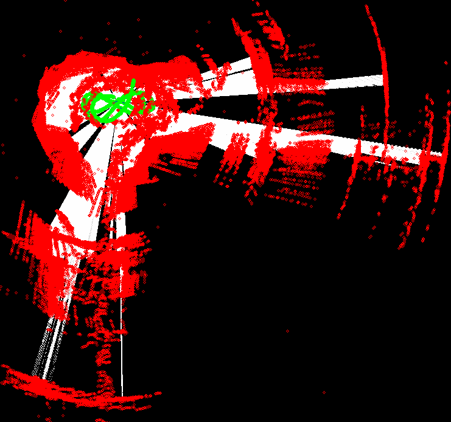
  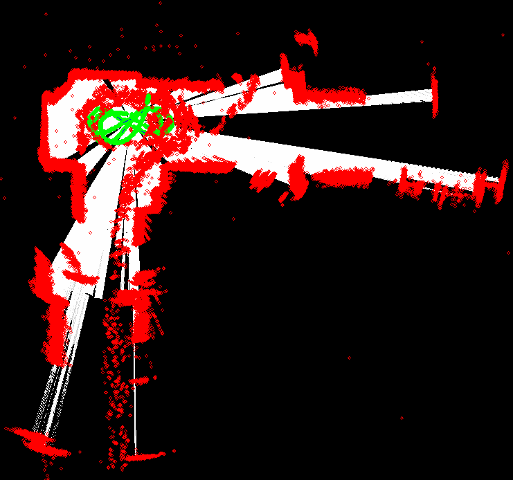
  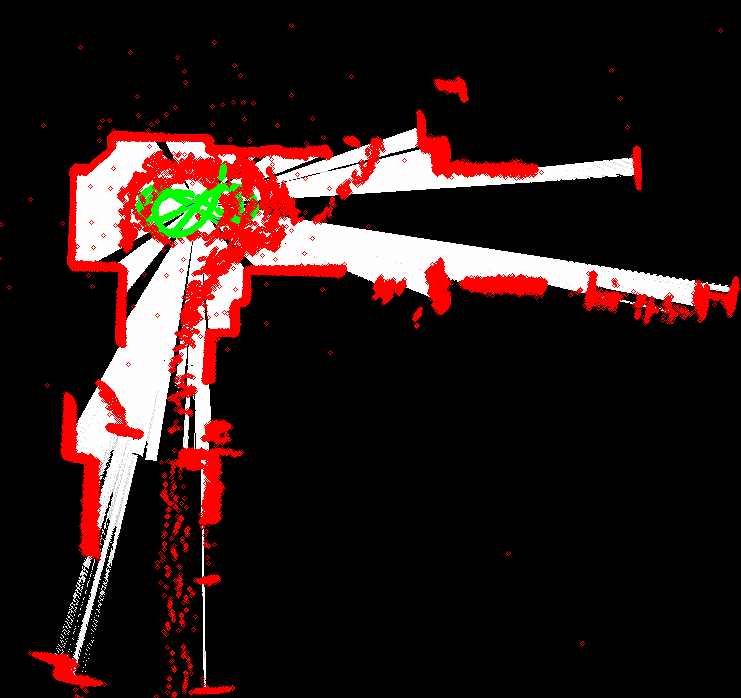
</p>
<p align="center"><em>DIAG scans: before deskewing (left), deskewed with nominal parameters (center), and deskewed with calibrated horizontal LiDAR parameters (right). Red: scans; green: localized trajectory.</em></p>

### Horizontal LiDAR and odometry calibration

The horizontal calibration optimizes the odometry parameters and the horizontal LiDAR pose so that the odometry trajectory follows the trajectory obtained by scan localization. The figures below show the DIAG progression: before calibration, after the first run, and after the second run. The repeated optimization brings the odometry estimate closer to the localized trajectory and reduces drift.

<p align="center">
  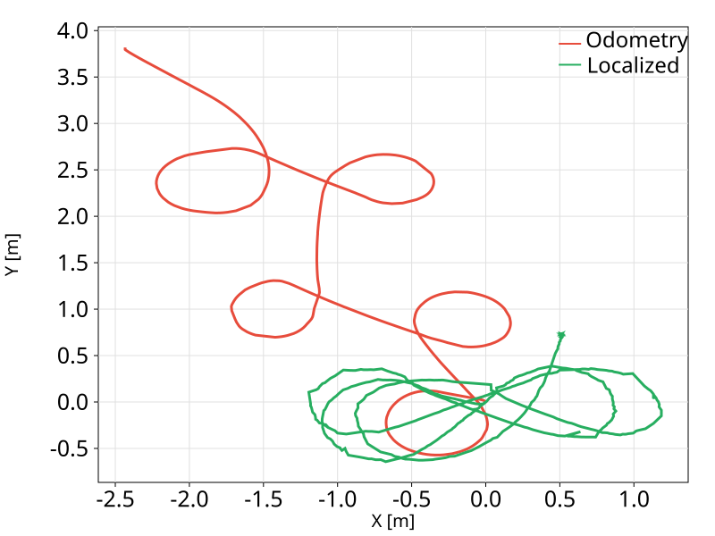
  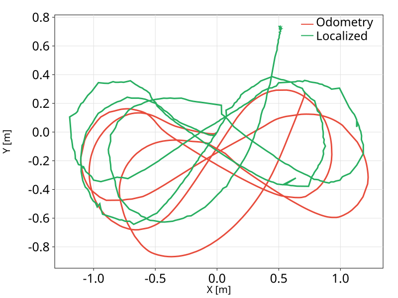
  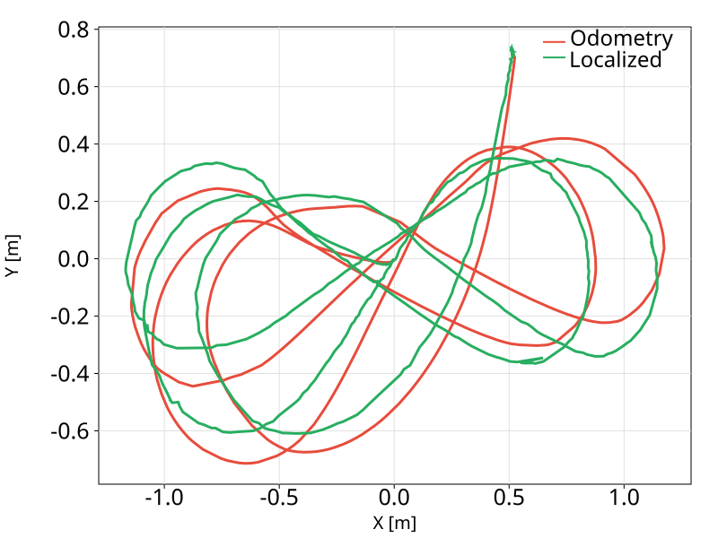
</p>
<p align="center"><em>Odometry (red) versus localized trajectory (green): before calibration (left), after the first run (center), and after the second run (right).</em></p>

In Hall, the parameters calibrated on DIAG already provide a close trajectory match; an additional calibration run further refines them. The estimated wheel baseline changes from 36.8 cm to 37.2 cm, while the horizontal LiDAR yaw changes from 92.4° to 92.0°.

<p align="center">
  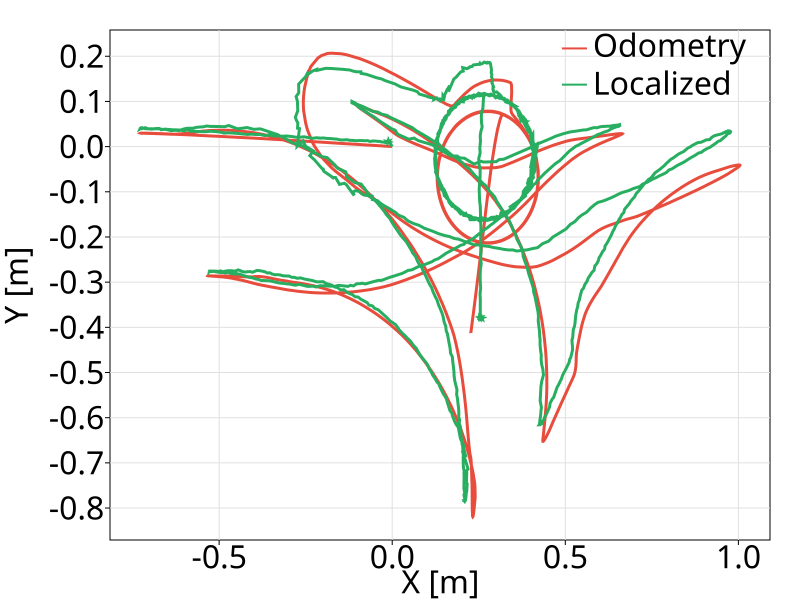
  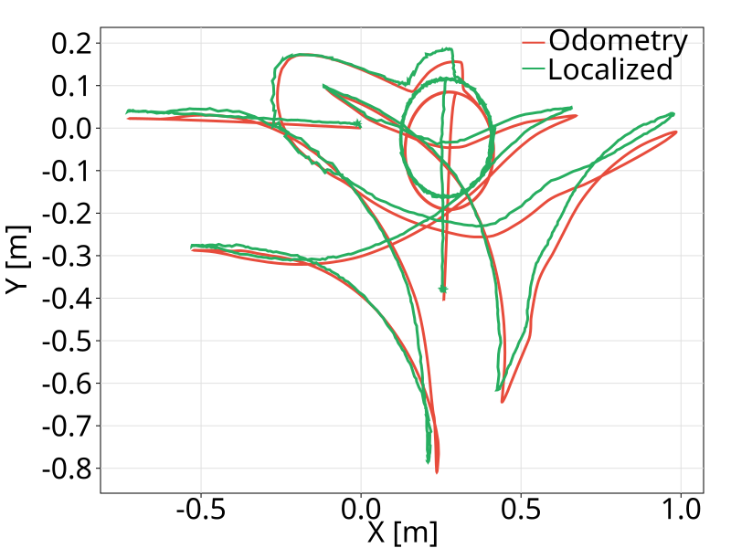
</p>
<p align="center"><em>Hall odometry (red) versus localized trajectory (green): using DIAG-calibrated parameters (left) and after Hall calibration (right).</em></p>

### Slanted LiDAR calibration

The top-down projections show floor points in blue and wall points in red. Calibration improves the consistency of the walls and the coverage of the floor. The 2D and 3D views below compare the DIAG and Hall reconstructions before and after calibration.

<p align="center">
  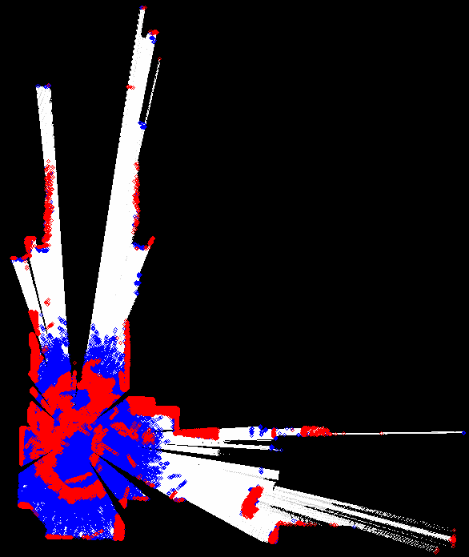
  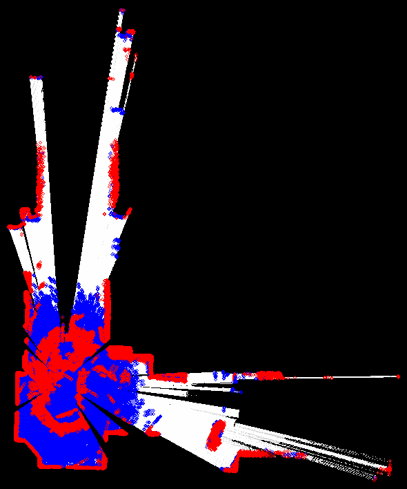
</p>
<p align="center"><em>Top-down point-cloud projection before calibration (left) and after calibration (right).</em></p>

<p align="center">
  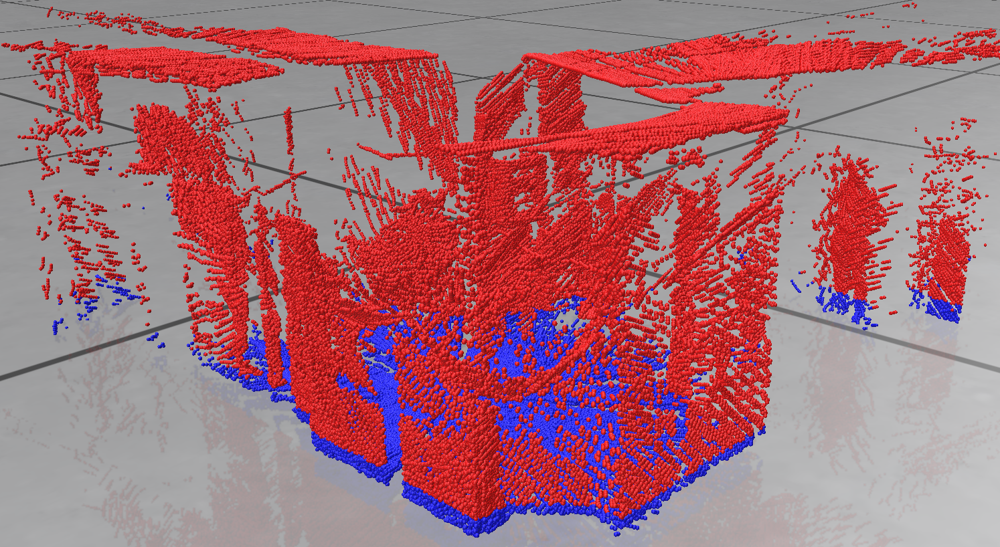
  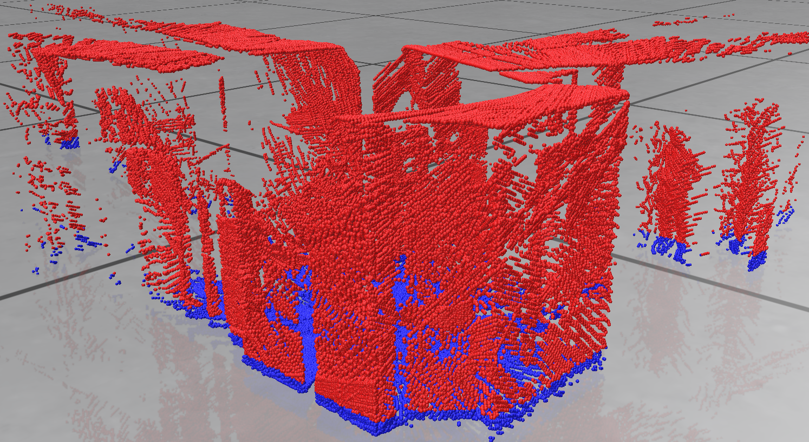
</p>
<p align="center"><em>3D reconstruction before calibration (left) and after calibration (right). Blue: floor points; red: wall points.</em></p>

<p align="center">
  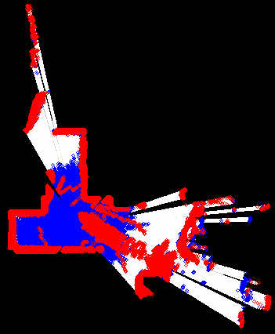
  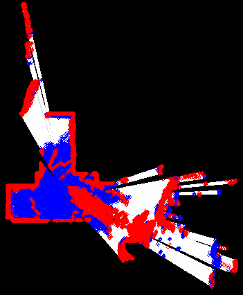
</p>
<p align="center"><em>Hall top-down point-cloud projection before calibration (left) and after calibration (right).</em></p>

<p align="center">
  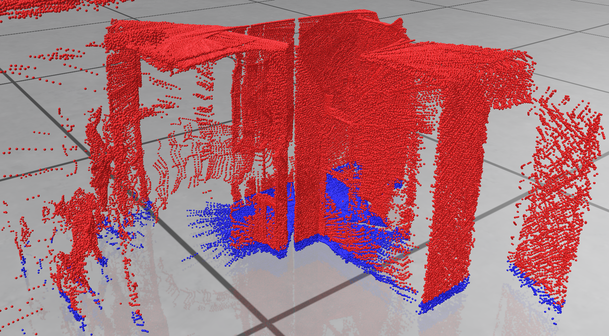
  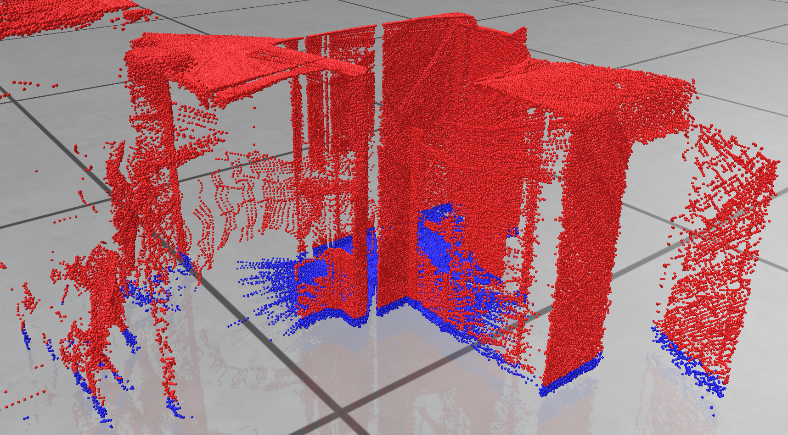
</p>
<p align="center"><em>Hall 3D reconstruction before calibration (left) and after calibration (right). Blue: floor points; red: wall points.</em></p>

### Floor-height measurements

Calibration reduced the spread of reconstructed floor-point heights in both datasets. A residual positive height bias remains, so these results show improved consistency rather than verified absolute accuracy.

| Dataset | Floor height standard deviation, before → after | Mean floor height, before → after |
| --- | ---: | ---: |
| DIAG | 2.0 → 1.8 cm | 1.3 → 1.1 cm |
| Hall | 2.2 → 2.0 cm | 1.0 → 1.6 cm |

## Zuppo — Map creation & LiDAR Calibration


The instructions below cover map generation and calibration. Run commands from the **repository root** unless a step says otherwise.

### Prerequisites

- ROS 2 Jazzy installed at `/opt/ros/jazzy`
- A built workspace with `install/setup.bash` available
- The `lidar_publisher` and `map_builder` packages present in your workspace

## 1. Generating the Map

This workflow uses three terminals running concurrently.

### Terminal 1 — Build the workspace

```bash
source /opt/ros/jazzy/setup.bash
source install/setup.bash
colcon build --packages-select lidar_publisher map_builder
```

### Terminal 2 — Run the cost map node

```bash
source /opt/ros/jazzy/setup.bash
source install/setup.bash
ros2 run map_builder map_builder --ros-args -p resolution:=0.02 -p max_range:=12.0
```

### Terminal 3 — Replay LiDAR data

```bash
ros2 run lidar_publisher lidar_publisher \
  --ros-args \
  -p map_path:=dataset/calibration/Hall/hall_log.txt \
  -p lidar_idx:=0 \
  -p halt_line:=33442
```

- `halt_line`: The last line before the robot starts moving.
- `max_range`: The LiDAR maximum range in meters.

### After the replay finishes

Back in **Terminal 1**, save the generated map:

```bash
ros2 run nav2_map_server map_saver_cli -f assets/map/my_map --fmt png
```

This produces `assets/map/my_map.png` (plus the accompanying YAML metadata file).

## 2. Calibration

### Step 1 — Configure parameters

If needed, edit the relevant parameters in `params.h` before building.

### Step 2 — Install dependencies

Make the setup script executable, then run it:

```bash
chmod +x setup.sh
./setup.sh
```

### Step 3 — Build the calibrator

```bash
cd src/zuppo_calibrator && mkdir build && cd build
cmake ../
make -j $(nproc)
```

### Step 4 — Run the calibrator

`zuppo_calibrator` takes the following arguments:

```text
./zuppo_calibrator <path_to_image: str> <resolution: float> <path_to_data:str> <plot:bool>
```

Example runs (from `/build`):

```bash
./zuppo_calibrator ../../../assets/map/Hall/hall.png 0.02 ../../../dataset/calibration/Hall/hall_log.txt true
```

## Doxygen documentation

Doxygen documentation can be found [here](https://brunoiannone.github.io/Calibration-framework-for-Zuppo-robot/).
